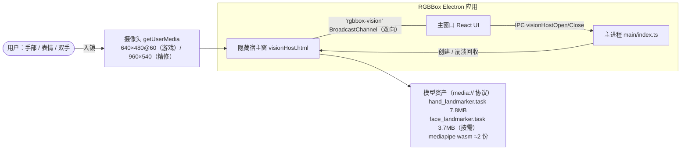
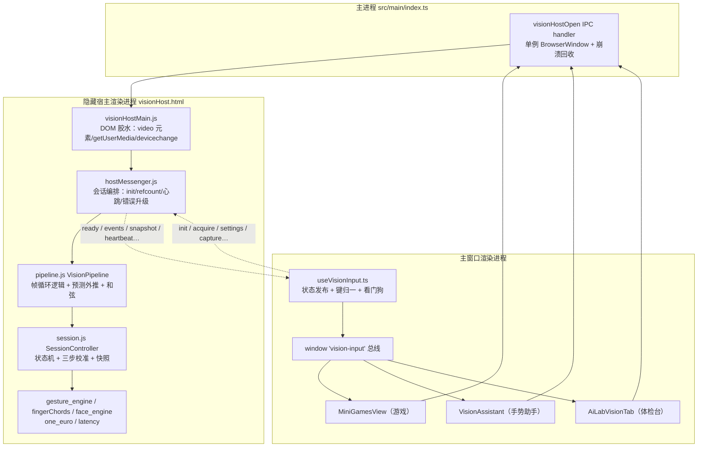
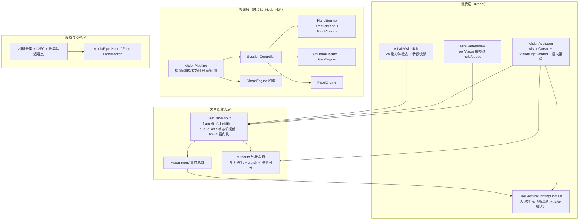
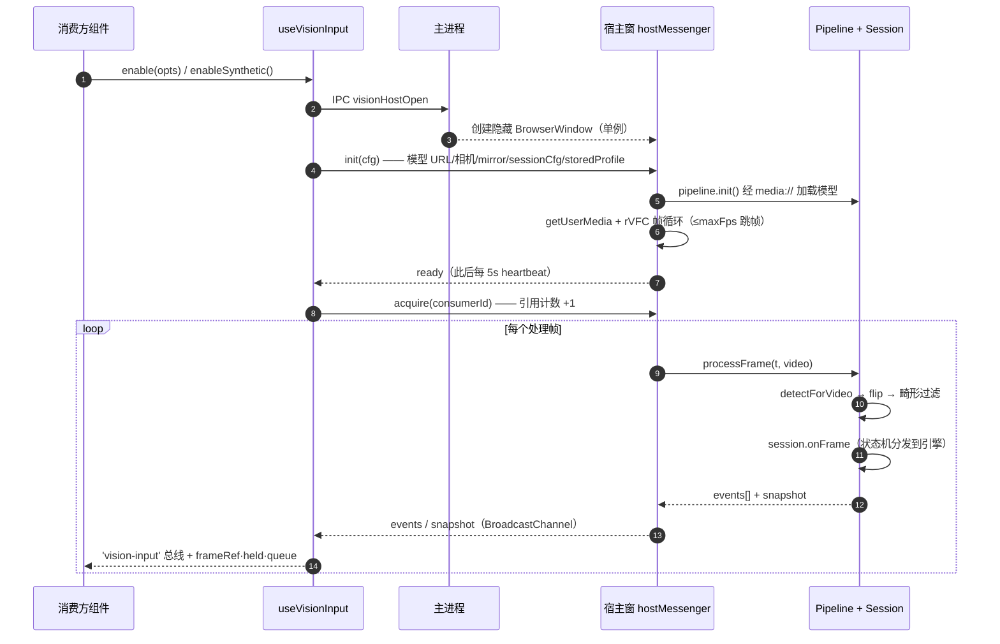
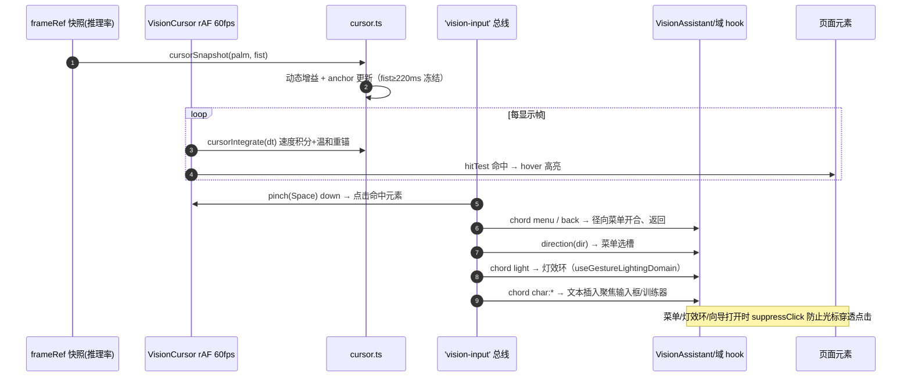
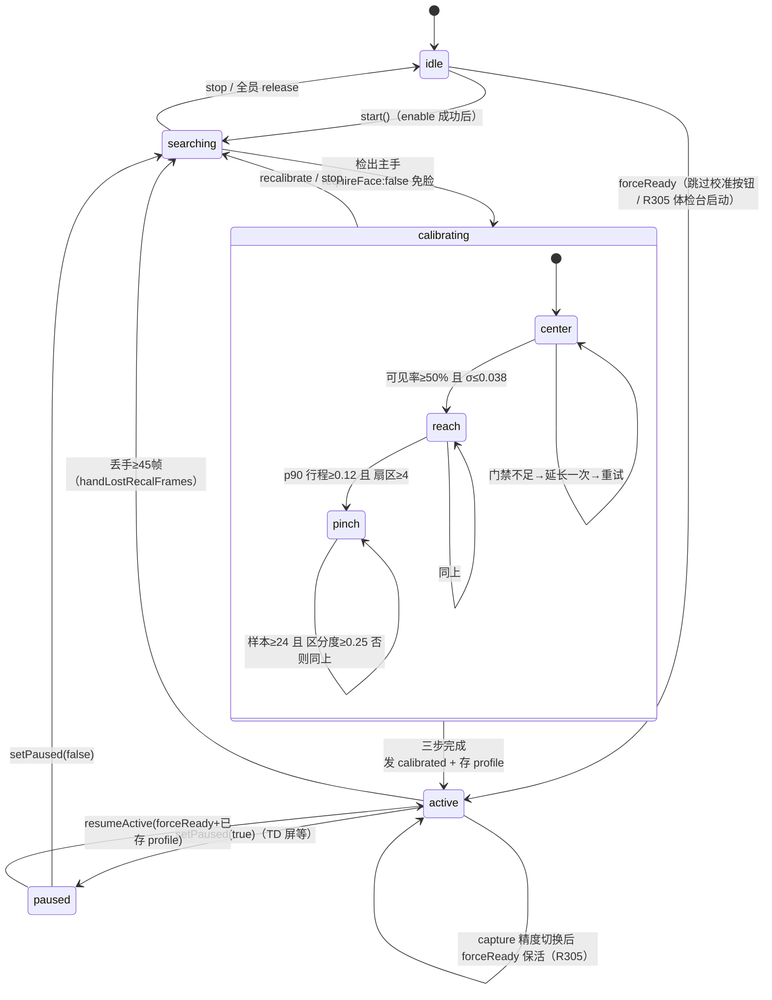

# 体感输入子系统架构文档（手势 / 表情 / 手势助手）

> **基线**：main @ `8ac1490`（2026-10-17，含 R305）
> **范围**：`src/renderer/src/vision/**`、`src/renderer/src/hooks/useVisionInput.ts`、三个消费方（MiniGamesView / VisionAssistant / AiLabVisionTab）、`src/main/index.ts` 的宿主窗生命周期
> **方法**：全部结论来自代码通读（R305 调查期间逐文件核实）；推断与未读部分标注并汇总到 §12
> **配套**：全系统架构见 [architecture.md](./architecture.md)；需求沿革见 [PRD-0002](./prd/PRD-0002-rgbbox-project-catalog.md)（R131–R149、R227–R249、R305）

---

## 1. Overview

体感子系统把摄像头画面变成**离散命令事件 + 连续快照**，供游戏、全局手势助手、AI 实验室体检台三类消费方使用。检测管线跑在一个**隐藏宿主渲染进程**里（不占主窗口主线程），双方经 `BroadcastChannel 'rgbbox-vision'` 通信；所有引擎与会话状态机是**零浏览器依赖的纯 JS**，可在 Node 全量单测（tests/vision 112 项）。

## 2. Architecture Context

主进程只管宿主窗**生命周期**（单例、`render-process-gone` 关窗），不接触任何视觉数据；宿主窗 `backgroundThrottling:false` 保证隐藏时 rVFC 不被节流。

## 3. Runtime Architecture（进程边界）

`useVisionInput` 每个 React 消费方各持一个实例，但宿主窗全局单例——多消费方通过 consumerId **引用计数**共存，最后一个 `release` 才真正关摄像头。

## 4. Logical Architecture（分层）

箭头方向=依赖方向。**Engine 纯 TS/JS、无 DOM/Electron** 是硬约束（tests/vision 112 项在 node 环境跑的根基）。

## 5. Component Responsibilities

| Component | 负责 | 不负责 |
|---|---|---|
| `hostMessenger.js` | 会话编排：init/ready、consumerId 引用计数、心跳 5s、帧错误升级（GPU→CPU 重建→干净关停）、capture 切换保 active（R305）、face 消费方原地升级（R305） | 帧内容计算、DOM/相机读取 |
| `pipeline.js`（VisionPipeline） | 每帧：landmarker 推理调用、镜像翻转、畸形手过滤、和弦注入（active 态）、掌心速度预测外推、统计 | 状态机决策、相机采集 |
| `session.js`（SessionController） | searching→校准→active 状态机、三步校准门禁（extend/retry）、主/副手分配、事件聚合、快照组装、profile 应用 | 模型加载、传输 |
| `gesture_engine.js` | DirectionRing（8 向滞回+确认）、PinchSwitch、Median3、OffHandEngine、GapEngine | 手指伸屈模式识别（在 fingerChords） |
| `fingerChords.js`（ChordEngine） | 五指伸屈→和弦命令/字符，Median3 滤波+稳定窗+**release 提交**（R143.3）、文本模式 | 离散按键语义（在消费方） |
| `face_engine.js` | 表情 blendshape→滞回开关（jawOpen/browRaise/smile），中立脸基线校准 | 人脸检测（MediaPipe） |
| `useVisionInput.ts` | 通道生命周期、事件→键归一（KeyE→e 等）、held/queue/frameRef、4Hz label 节流 + 状态即时发布、心跳看门狗一次自愈、镜像/主手/灵敏度持久化 | 手势语义消费 |
| `cursor.ts` | 相对光标纯状态机：抖动死区、速度动态增益、握拳 clutch 冻结、显示率积分+anchor 重锚、hitTest | DOM 命中元素收集（VisionCursor 组件）(推断) |
| `VisionAssistant.tsx` | 助手总开关（显式模式）、径向菜单（chord menu + direction 选槽 + pinch 确认）、和弦文本输入+训练器、首用向导挂载、窗口隐藏停摄像头 | 管线生命周期（games 视图内让位给游戏 hook） |
| `useGestureLightingDomain` | 灯效环 v2：亮度调节（张掌 Y 轴）、冻结、撤销、双捏合窗口 | 效果渲染（引擎层） |
| `AiLabVisionTab.tsx` | 24 能力目录行点亮、三条客户端组合（双捏合/张掌保持/握拳 clutch）、原始信号面板、**R305 启动即 active** | 校准 UI（pad 画布只读展示） |
| `MiniGamesView` 视觉接线 | pollVision 轮询 held/queue 进游戏、dirs 4/8 按游戏切换、VisionBanner 状态横幅、TD 屏 paused+免重校准 | 检测与状态机 |
| `src/main/index.ts`（视觉部分） | 宿主窗单例创建/回收、media:// 资产路由 | 任何视觉数据 |

## 6. 关键链路一：启动握手与帧主链路

合成模式（E2E）以 33ms 定时器替代 rVFC，其余路径同一管线。帧错误连续 ≥8 次触发 GPU→CPU 重建，仍失败则干净关停并回 error。

## 7. 关键链路二：手势助手（光标 + 菜单 + 灯效环）

相对光标 + 客户端预测是延迟对策的两半——管线侧 50ms 前瞻（R142-L2）照顾连续量，消费侧积分重锚（R143.1）让 100ms+ 管线后的光标"手感直连"。

## 8. 会话状态机（SessionController）

**事件只在 active 产生**（calibrating/searching 下引擎不跑，和弦被 pipeline 门禁）——这正是 R305 报障的根因：体检台曾卡在 calibrating 导致除两条快照驱动行外全部静默。

## 9. Interface / Contract

**client → host**（`hostProtocol.js HOST_MSG`）：

| 消息 | 载荷 | 语义 |
|---|---|---|
| init | cfg{mode,bundleUrl,wasmBase,handModel,faceModel,numHands,camera,maxFps,mirror,sensitivity,storedProfile,sessionCfg} | 建会话；重复 init 只回 ready（face 需求可触发原地升级，R305） |
| acquire / release | consumerId | 引用计数；最后一人 release 关摄像头 |
| settings | patch{confirmMs,activeZone,pinchOn…} | 运行时调参（灵敏度预设走 confirmMs） |
| pause / recalibrate / forceReady | p / — / profile | 状态机控制 |
| mirror / primaryHand | m / 'Left'｜'Right' | 镜像与主手角色，客户端持久化 |
| textmode / backspace | on | 和弦文本模式 |
| capture | camera{width,height,frameRate} | 精度切换（重建流，保 active） |
| stop | — | 强停并清空注册表（E2E 用） |

**host → client**：

| 消息 | 载荷 | 说明 |
|---|---|---|
| ready / heartbeat | delegate / — | 握手完成；5s 心跳（>15s 静默→客户端一次自愈） |
| events | VisionEvent[] | 见下表 |
| snapshot | VisionFrame（state/label/stepId/geom/geomPredicted/pickedLandmarks/allHands/profile/statusKey/stats/chordPreview/chordBuffer…） | 每处理帧一条，不受 4Hz 节流 |
| status / error / profile-save | s / message / profile | 引擎码本地化在客户端；profile 存 localStorage `vgi-profile-v2` |

**总线事件 `vision-input`（VisionEvent）与手势词汇 → 消费方**：

| 手势 | 产生处 | 事件形状 | 消费方 |
|---|---|---|---|
| 8 向方向环 | DirectionRing | `{kind:'direction',key,down,dir}` | Survival/Tetris 移动、径向菜单选槽、体检台 |
| 捏合 | PinchSwitch（Median3 后） | `{kind:'pinch',key:'Space',down}` | 游戏确认/开局、轮盘确认、光标点击、双捏合组合 |
| 双捏合 | 客户端组合（两次 pinch down <900ms） | —（合成） | 升级轮盘、体检台行 |
| 张掌保持 | 客户端组合（geom.pinch>off 700ms）/ 副手 OpenPalmHold 800ms | 副手发 `{kind:'offhand',name:'pause'}` | 游戏开局/重开、暂停请求 |
| 握拳 clutch | 客户端组合（四指屈 ≥250ms）+ cursor.ts fist 冻结 | —（快照驱动） | 光标精修、体检台行 |
| 和弦命令 | ChordEngine（release 提交） | `{kind:'chord',name}` | menu→径向菜单 / back→返回 / light→灯效环 / select·confirm→光标与游戏 |
| 和弦文本 | ChordEngine textMode | `{kind:'chord',name:'char:*'}` | 助手文本输入 + 训练器 |
| 表情 | FaceEngine（中立脸基线滞回） | `{kind:'face',name,key,down}` | 修饰键预留（R135.3）、体检台（需 face:true） |
| 双手张合 / 副手捏合 | GapEngine / OffHandEngine | `{kind:'hands',name}` / `{kind:'offhand',name:'pinch'}` | 预留 + 体检台 |

## 10. Non-Functional Requirements

| Category | Requirement（代码事实） |
|---|---|
| 推理预算 | 游戏默认 faceless（省 FaceLandmarker 每 3 帧 +34.6ms GPU，R249.2）；推理上限 maxFps=60；相机 640×480@60，精修 960×540 |
| 延迟 | 确认窗口毫秒制：灵敏度 standard/fast/sport = 90/45/0ms；方向环死区 0.09/触发环 0.17；采集延迟 p95 埋点（presentationTime 差） |
| 可靠性 | 畸形 landmark 丢弃计数；低置信帧（<0.7）冻结状态机 8 帧后按丢失处理；心跳 15s 超时一次自愈、二次报错卡；init 20s 超时；GPU→CPU 重建 |
| 隐私 | 窗口隐藏/最小化即 disable 摄像头（主进程权威可见性推送） |
| 资产预算 | 模型+wasm ≈32MB 打包，符合 ≤100MB 硬预算 |
| 兼容 | Electron file:// 经 media:// 自定义协议加载模型；镜像是运行时开关（相机摆位差异） |
| 帧数据纪律 | 消费方一律 ref（frameRef/heldRef/queueRef），React state 只承载 4Hz 文本与即时状态元组 |

## 11. Key Decisions (ADR)

| ID | Decision | Status | Alternatives | Reason | Impact |
|---|---|---|---|---|---|
| ADR-001 | 检测管线放隐藏宿主渲染进程 | Accepted | 主窗口主线程 / Web Worker | MediaPipe wasm 内嵌 worker 嵌套失败（ModuleFactory not set）；主线程方案挤游戏帧（R136 诊断①） | 多一层进程与通道协议；主窗口零推理成本 |
| ADR-002 | 确认窗口用毫秒而非帧数 | Accepted | 帧计数 | 暗光自动曝光掉帧时帧数确认隐性加倍延迟 | 弱光下行为稳定 |
| ADR-003 | 事件仅 active 态产生 | Accepted | 全状态直通 | 校准期手指属于向导，直通会污染采样 | 需要跳过/免校准路径（R305 体检台 forceReady） |
| ADR-004 | 默认 faceless，体检台 opt-in | Accepted | 全局加载 face | 游戏/助手无表情消费方，加载即浪费（R249.2）；体检台表情行是 try-it-now（R305） | 重复 init 时 face 需求原地升级，单向不降级 |
| ADR-005 | 宿主会话引用计数 | Accepted | 单消费方独占 / 每消费方一会话 | 游戏/助手/体检台共存，互不杀摄像头（R228） | release 语义复杂（幂等、最后者关） |
| ADR-006 | 心跳看门狗一次自愈 | Accepted | 无自愈 / 无限重启 | 挂死渲染进程无法告别；防重启风暴（R244） | 二次静默走错误卡 |
| ADR-007 | 相对光标 + 握拳 clutch | Accepted | 绝对映射 | 绝对映射继承相机 FOV/镜像/装配三重误差（R142-L3） | 需 clutch 重定位手势；张掌保持自然休息位不冻结 |
| ADR-008 | 双侧预测：管线 50ms 前瞻 + 客户端积分重锚 | Accepted | 仅服务端 / 仅客户端 | 离散事件须确认门控，连续量可安全超前（R142-L2/R143.1） | 两套预测逻辑需保持语义一致 |
| ADR-009 | 和弦 release 提交（松手才发） | Accepted | 成形即发 | 途经更宽和弦不应误发（R143.3） | 命令延迟一个释放动作 |
| ADR-010 | capture 切换保 active | Accepted | 切换即重跑向导 | 换分辨率不是重新校准的理由（R133.4 原则推广，R305） | 仅 active 保活，校准中仍重跑 |
| ADR-011 | 引擎层零 DOM/Electron 依赖 | Accepted | 渲染层直接实现 | 112 项 vision 单测跑在 node；可移植 Web/WASM | 需要注入式 loader/DOM 胶水分层 |

## 12. 待确认项

- [ ] `VisionCursor.tsx` / `VisionLightControl.tsx` / `VisionOnboarding.tsx` 组件内部实现（本文仅依据 props、`cursor.ts`/`onboarding.ts` 纯模块与 R-N 记录；光标"点击命中元素"的具体 DOM 机制未逐行核实）(推断)
- [ ] `useGestureLightingDomain` 完整手势集（读了常量/签名：ADJUST_HOLD_MS 600、双捏合窗口 900ms、亮度 Y 轴映射，未读全部实现分支）
- [ ] `MiniGamesView.pollVision` 逐行实现（确认了接线点与 dirs 4/8 切换，未读完整命令映射）
- [ ] `visionHostMain.js` 除模型 loader 外的胶水（devicechange/onended 接线从 hostMessenger 注释确认存在）(推断)
- [ ] `one_euro.js` / `latency.js` / `synthetic.js` 未读（滤波参数在调用处已见：minCutoff 2.5, beta 0.5）
- [ ] GPU delegate 在目标真机的实际 p95（PRD 各 R-N 均标注"真机验收留用户"）
